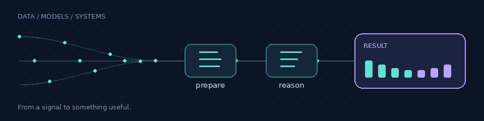

# Salahddine Jabour

I build AI applications from the first data flow to the API, interface, and deployment. I am a final-year **Data Science and Computer Science engineering student at FST Mohammedia, Morocco**, interested in the decisions that turn a model into a useful application.

## Building Jenoxa

With **Jenoxa**, a recruiter defines campaign criteria, receives CVs, and reviews a ranking prepared from those criteria. I designed and deployed the platform end to end: the interface, API, CV extraction and evaluation, asynchronous processing, and deployment. FastAPI and Next.js connect the user journey; PostgreSQL, Redis, Celery, and Docker support the processing behind it.

**[Visit Jenoxa →](https://jenoxa.com)**

## Projects to explore

| Project | Why open it? |
| --- | --- |
| [LearnLab AI](https://github.com/Jabour-Salahddine/learnLab-ai-pub) | Follow a student's code submission through execution, evaluation, and a LangGraph decision between a hint and a profile update. |
| [BidConnect](https://github.com/0lafwan/BidConnect) | Explore a team-built tender workflow where uploaded documents move through MinIO storage and RAG ingestion for a contextual assistant. |
| [Movie recommendation pipeline](https://github.com/Jabour-Salahddine/machine-learnia-pipelines) | See how SVD training is tracked with ZenML and MLflow, alongside an API that handles returning and unknown viewers. |
| [myBank microservices](https://github.com/Jabour-Salahddine/myBank-Microservices) | Trace a customer request across banking services, gateway resilience, identity checks, and observability configuration. |
| [Employee Management API](https://github.com/Jabour-Salahddine/Spring-Boot-Employee-Management-Complete-REST-API) | Walk through JWT authentication, employee operations, role-restricted deletion, and a layered Spring Boot design. |
| [Python Job Finder](https://github.com/Jabour-Salahddine/Web-Scraping-Intro) | Turn HTML job listings into a readable shortlist using date filters, skill exclusions, and local text exports. |

## What I build with

| Domain | Tools I use | Where they come together |
| --- | --- | --- |
| AI and machine learning | Python, LangGraph, RAG, Qdrant, Surprise SVD, MLflow, ZenML | LearnLab, BidConnect, movie recommendations |
| APIs and services | FastAPI, Java, Spring Boot, Spring Cloud, JWT, Keycloak | Jenoxa, LearnLab, myBank, Employee API |
| Data and asynchronous work | PostgreSQL, MySQL, Redis, Celery, Kafka, MinIO | Jenoxa, recommendation pipeline, BidConnect |
| Interfaces and delivery | Next.js, React, Docker, Prometheus, Grafana, OpenTelemetry | Jenoxa, LearnLab, myBank |

## Looking for a PFE internship — January 2027

I am looking for a final-year internship in **AI or Data starting in January 2027**. I enjoy connecting model behavior with the data, services, and user workflows around it.

[Contact me on GitHub](https://github.com/Jabour-Salahddine) · [Explore Jenoxa](https://jenoxa.com)
